# DA-DAKA | Solar-Panel Cleaning Drone

**기체설계·제작에서 Pixhawk 기반 호버링과 영상 인식 시스템 통합까지**

태양광 패널을 세척하기 위해 제작한 약 **2.8 kg급 4축 X형 드론**입니다. 이 포트폴리오는 기체의 구조와 부품을 어떻게 정하고, 제작·비행시험에서 발견한 문제를 어떤 형상 변경으로 해결했는지에 초점을 둡니다.

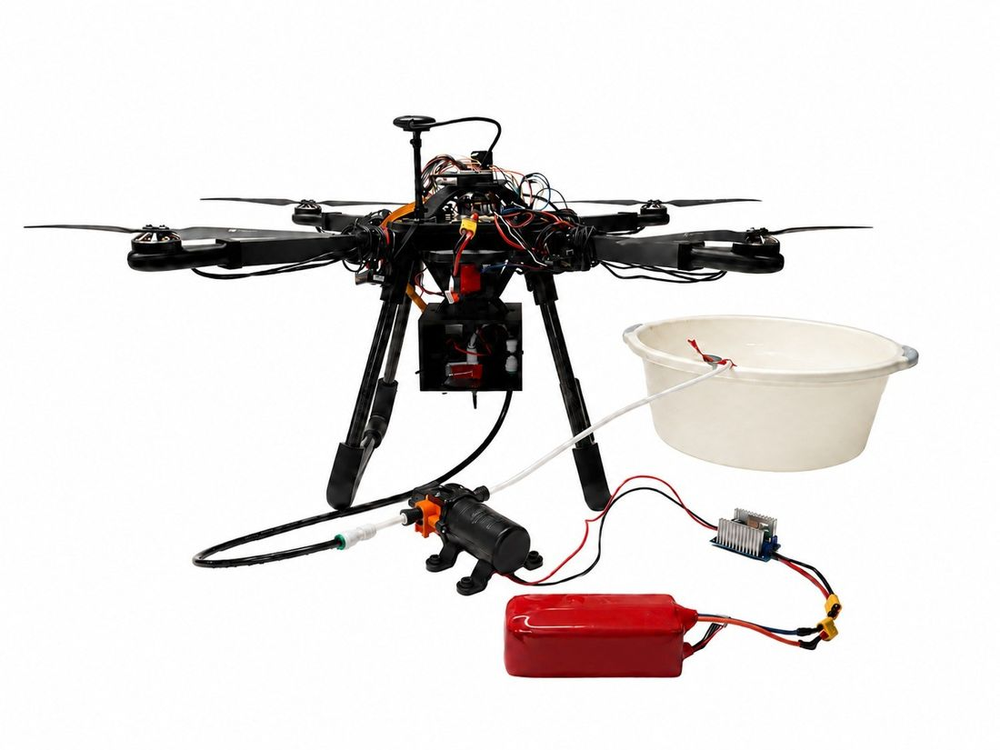

물탱크와 펌프는 지상에 두고 호스로 급수합니다. 기체가 지지해야 하는 탱크 하중을 줄이는 대신, 호스 연결 위치와 장력까지 장비 배치에 반영했습니다.

**직접 수행:** Fusion 360 기체설계, 부품 선정, 프레임·마운트 제작, 전장 배치·조립, 무게중심 측정과 기체 시험. 비행제어 튜닝과 AI·임무 소프트웨어는 팀 협업 결과로 설명합니다.

## 01. 설계 조건과 기체 구성

기체는 추진부 외에도 Pixhawk, 임무 컴퓨터, 카메라, LiDAR, 배터리와 분사장치를 지지해야 했습니다. 모터를 연결하는 암의 고정, 중앙 프레임의 장비 공간, 배터리와 호스 연결부의 위치를 하나의 조립체로 검토했습니다.

| 항목 | 적용 구성 | 설계에서 검토한 점 |
|---|---|---|
| 중앙 프레임 | 약 218 mm, PLA+ | 전장품 배치, 암 체결, 하부 장비 공간 |
| 암 | 외경 18 mm 카본 튜브 4개 | 중앙부와 모터부의 체결, 회전 억제 |
| 모터 | Gartt ML3508 700 KV × 4 | 장비 탑재 후 필요한 추력 |
| 프로펠러·ESC | T-Motor MS1302 13 inch, 50 A급 ESC × 4 | 추진계 조합과 출력 여유 |
| 배터리 | 4S 14.8 V 5,000 mAh 65 C | 질량 분포와 중앙 하부 배치 |
| 비행·임무 장치 | Pixhawk 4/PX4, Raspberry Pi 5 | 고정 위치, 배선, 센서 연결 |
| 센서 | IMX708, TF-Luna, M10 GPS·나침반 | 관측 방향과 기체 장착 |
| 급수 | 외경 8 mm·내경 5 mm 호스 | 연결부 하중, 호스 간섭과 당김 |

218 mm는 중앙 프레임의 표기이며 전체 축간거리가 아닙니다. 부품별 치수와 하중 조건은 [설계 상세 기록](docs/mechanical-design.md)에서 설명합니다.

## 02. 초기 CAD에서 제작 가능한 구조로

| 초기 기체 모델 | 카본 튜브 적용 후 모델 |
|---|---|
| 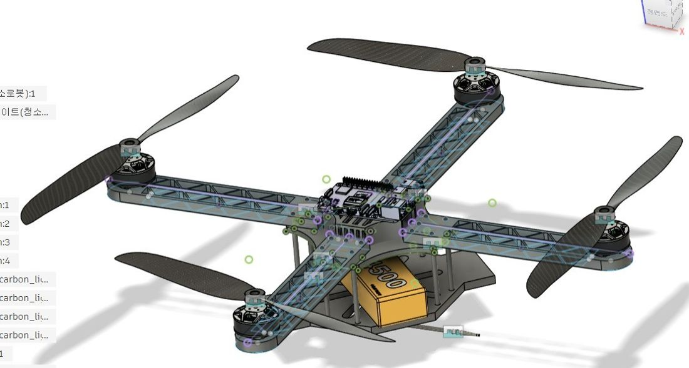 | 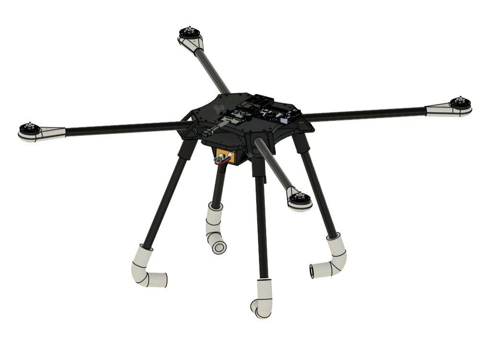 |

초기 모델에서 중앙 프레임·암·모터와 착륙장치의 관계를 검토한 뒤 카본 튜브를 사용하는 구조로 변경했습니다. 중앙부와 모터부는 별도 마운트로 연결하고, 하부에는 배터리와 호스 체결부를 위한 공간을 구성했습니다. 이후 설계의 핵심은 암 부재 자체에서 **실제 접합부의 고정 성능**으로 이어졌습니다.

## 03. 비행시험에서 바뀐 마운트와 장비 배치

### 카본 튜브가 회전하는 문제

호버링 중 원형 카본봉이 마운트 내부에서 미세하게 회전하면서 모터 수평이 틀어졌습니다. 모터 장착 방향을 유지하기 위해 카본봉을 감싸는 전용 마운트를 제작하고 중앙 플레이트 측과 모터 측의 체결 형상을 개선했습니다.

| 중앙 플레이트와 암의 연결 | 암과 모터 고정부의 연결 |
|---|---|
| 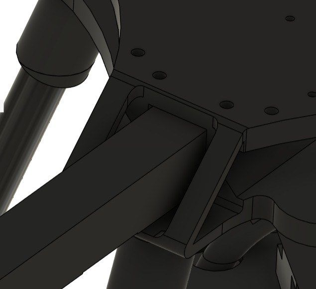 | 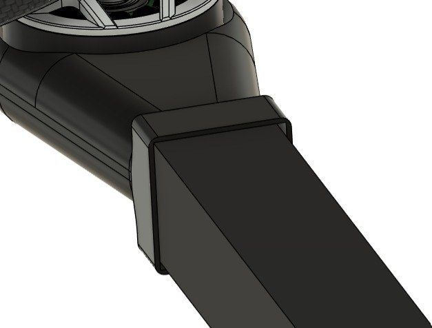 |

사각 외형의 마운트를 기체에 고정하고 카본봉을 삽입해 덮는 구성입니다. 개선 후 모터 수평 유지가 개선된 것으로 기록했습니다. 마운트 외형만으로 회전 저항을 설명할 수는 없으므로, 정량 회전각·체결 토크·반복 내구성은 후속 확인 항목입니다.

### 배터리와 호스 연결부를 중앙에 모으기

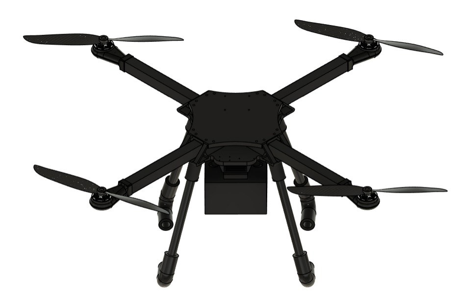

호스와 센서가 추가되면서 질량 분포가 비대칭이 되었습니다. 하부 중앙 박스 안에 호스 체결부를 수납하고 그 위쪽에 배터리를 배치했습니다. 무거운 부품의 수평 편심을 줄이는 방향으로 위치를 조정했으며, 비행제어기와 임무 컴퓨터의 배치도 함께 검토했습니다.

| 전후 CG 편차 | 좌우 CG 편차 | 합성 편차 |
|---:|---:|---:|
| 6 mm | 4 mm | 약 7.2 mm |

합성값은 `√(6² + 4²) ≈ 7.21 mm`입니다. 조정 전후 각각의 값이 제공되지 않아 개선율로 표현하지 않았습니다. 배터리를 아래로 배치하는 것과 호스가 당기는 외부 모멘트는 별도 문제이므로, 호스 조건이 바뀌는 비행시험까지 연결했습니다.

## 04. 실기체 제작과 추진계 확인

| 실제 기체의 상면 배치 | 중앙 전장부 |
|---|---|
| 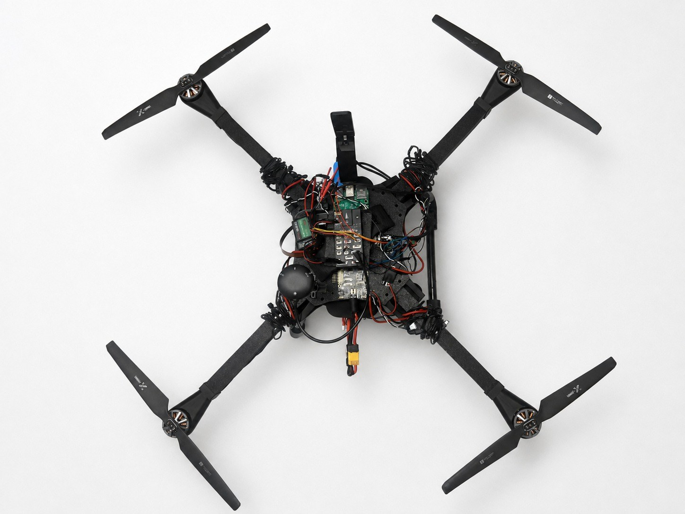 | 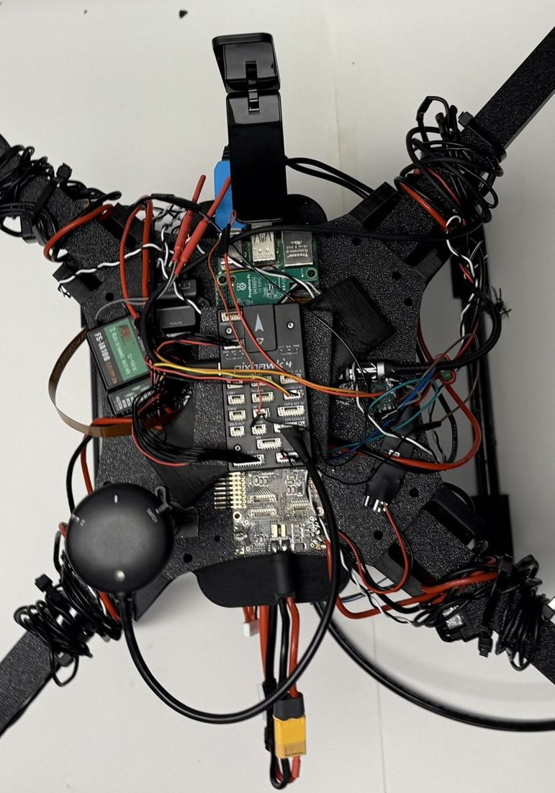 |

중앙 프레임에 전장품을 통합하고 PM07과 5 V UBEC로 전원 분배·공급 구성을 마련했습니다. 조립 과정에서는 부품 위치와 배선 경로가 암·프로펠러·하부 호스와 간섭하지 않는지 검토했습니다.

기체 질량 약 2.8 kg에 대해 스로틀 70%에서 모터 1개당 약 1.5 kgf의 추력이 기록되어 있습니다. 같은 시험 조건의 모터 4개 값을 단순 합산하면 `6.0 / 2.8 ≈ 2.14`의 추력/중량 비가 됩니다. 이는 최대 추력이나 추가 탑재량이 아니라 장비 탑재 기체의 추력 여유를 살펴보는 참고 계산입니다.

## 05. Pixhawk 설정·캘리브레이션·PID 튜닝

기체를 조립한 뒤 FC가 인식하는 축과 실제 기체 방향, 모터 배열과 출력 연결을 맞추고 호버링 응답을 확인했습니다. **캘리브레이션은 센서의 기준을 맞추는 단계**, **PID 튜닝은 목표 자세에 대한 실제 응답을 조정하는 단계**입니다.

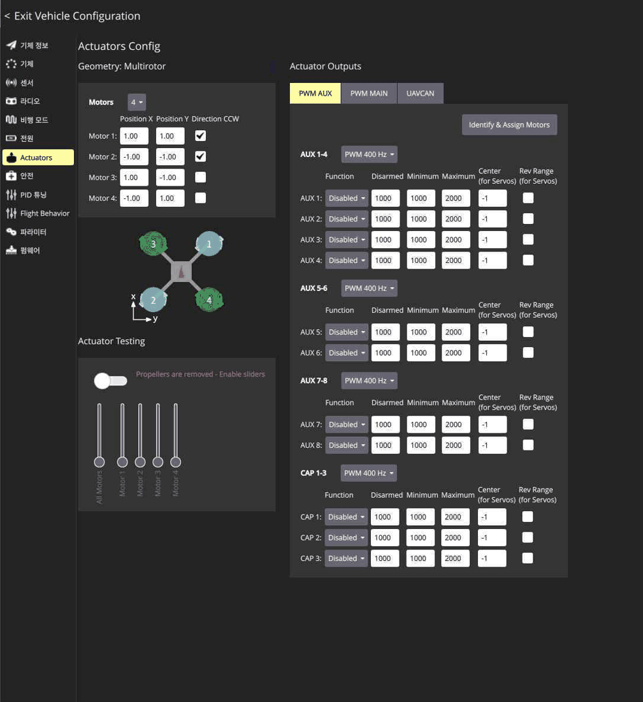

*제작설계서에 수록된 모터 구성·출력 시험 화면입니다. 센서 캘리브레이션 완료 화면과는 구분합니다.*

센서 보정에서 확인해야 하는 항목은 FC 장착 방향, 가속도계의 축·중력 기준, 자이로의 정지 기준, 나침반 방향, 수평 자세입니다. 현재 자료에는 보정 단계별 완료 캡처와 보정값이 없어 완료 이력을 임의로 만들지 않았습니다. 각 항목이 이 기체에 왜 필요한지는 [Pixhawk 설정과 튜닝 상세](docs/pixhawk-calibration-and-pid.md)에 정리했습니다.

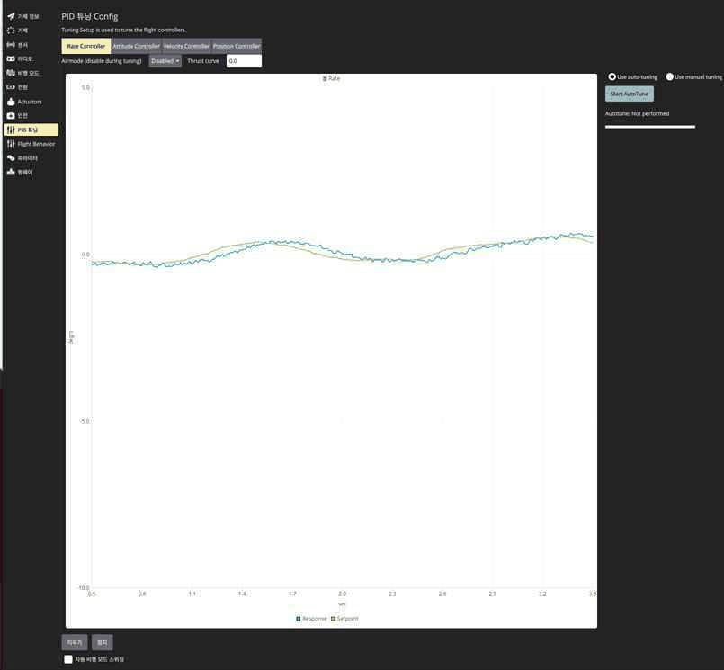

QGroundControl의 목표값과 실제 응답을 비교하며 추종 지연·진동·오버슈트를 살피고, 실기체 로그를 기준으로 제어조건을 조정했습니다. 먼저 마운트 회전과 무게중심 같은 기계적 문제를 해결하고 비행제어 조건을 검토했습니다.

| 호버링 지표 | 조정 전 | 조정 후 |
|---|---:|---:|
| 최대 Roll | 4.6° | 2.1° |
| 최대 Pitch | 5.1° | 2.4° |
| 평균 위치오차 | 0.14 m | 0.06 m |
| 안정화 시간 | 2.7 s | 1.4 s |

*프로젝트 기록의 팀 시험 결과입니다. 구조 변경만의 효과나 특정 PID 게인 하나의 효과로 해석하지 않습니다.*

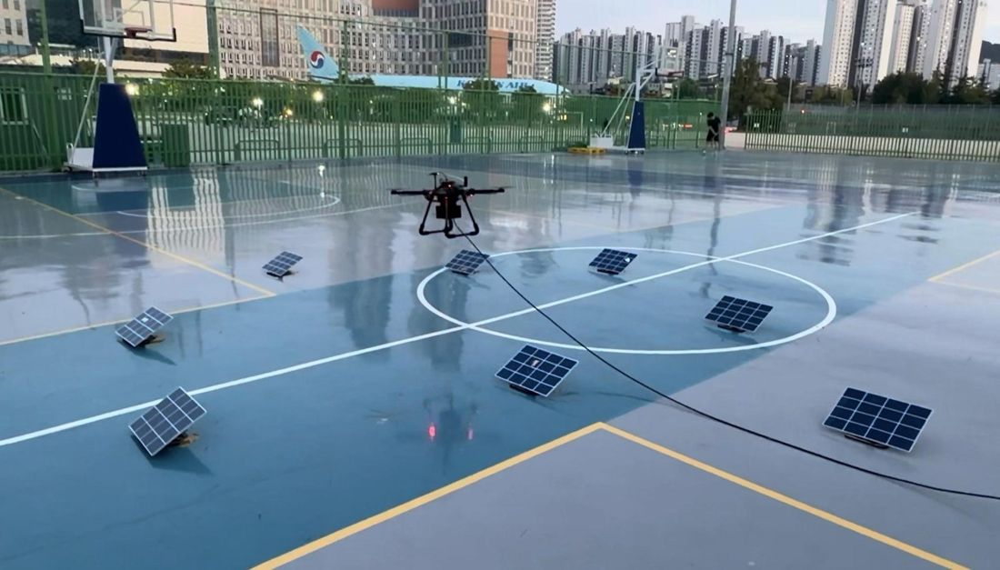

## 06. 기체에 연결된 영상 인식 시스템

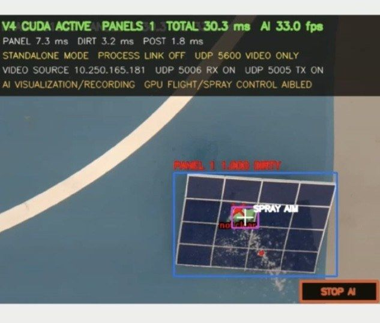

IMX708 영상은 Raspberry Pi 5를 거쳐 외부 GPU 노트북으로 전달됩니다. Panel V4가 패널을 찾고, 패널 ROI에 Dirt V3를 적용해 오염 영역과 중심좌표를 계산합니다. GPU 노트북은 기체 탑재품과 구분합니다.

| 단계 | 현재 프로젝트 문서의 모델·처리 |
|---|---|
| 패널 검출 | Panel V4 / Faster R-CNN MobileNetV3-Large FPN |
| 오염 분할 | Dirt V3 / LR-ASPP MobileNetV3-Large |
| 위치 산출 | Segmentation Mask + Centroid |

카메라 장착과 기체 흔들림은 관측 조건에 영향을 줍니다. 기체 제작과 FC 안정화는 이 인식 시스템을 운용할 하드웨어 기반이며, 모델 학습·추론은 팀 협업 성과입니다.

## 07. 설계 자료와 읽는 순서

- [기체설계 상세](docs/mechanical-design.md): 하중 전달, 마운트, CG·전장 배치와 설계 판단.
- [Pixhawk 캘리브레이션·PID](docs/pixhawk-calibration-and-pid.md): 보정 항목, 실제 QGC 화면과 호버링 결과.
- [제작설계서 PDF](attachments/design-specification.pdf): 원본 제작설계서를 별도 파일로 첨부했습니다.

사진과 수치는 제공된 프로젝트 자료에서 발췌했습니다. CAD 원본·원시 비행 로그 없이 확인할 수 없는 치수나 성능은 확정값으로 추가하지 않았습니다.

## 08. How It Works | 실제 코드의 동작 원리

각 기능의 구체적인 데이터 흐름과 실제 설정을 [**핵심 코드 이해하기**](docs/code-guide.md)에 정리했습니다.

**FSM 임무제어 → Capture-Sync → NN + 2-opt → AI 최신성 검사 → TF-Luna 거리 PID → Safety Gate → 3초 분사 → Fresh Verify**
