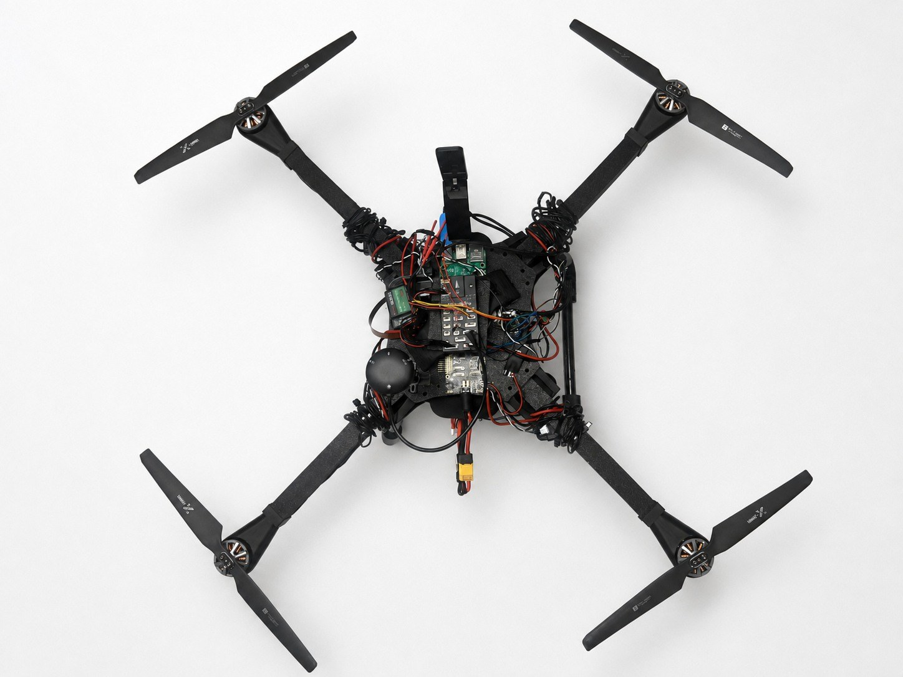
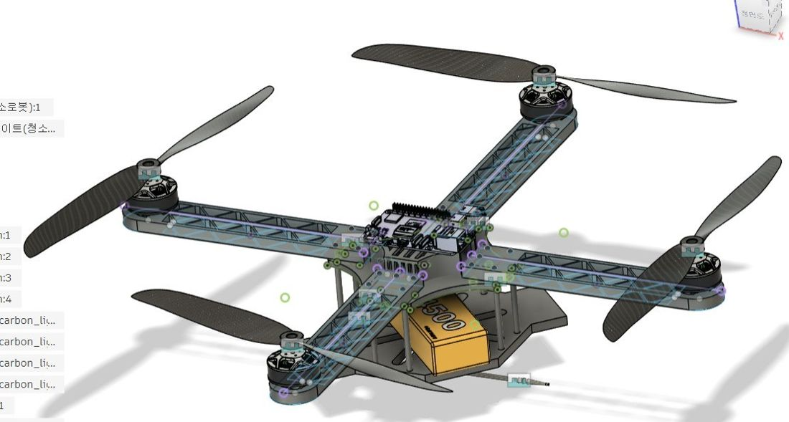
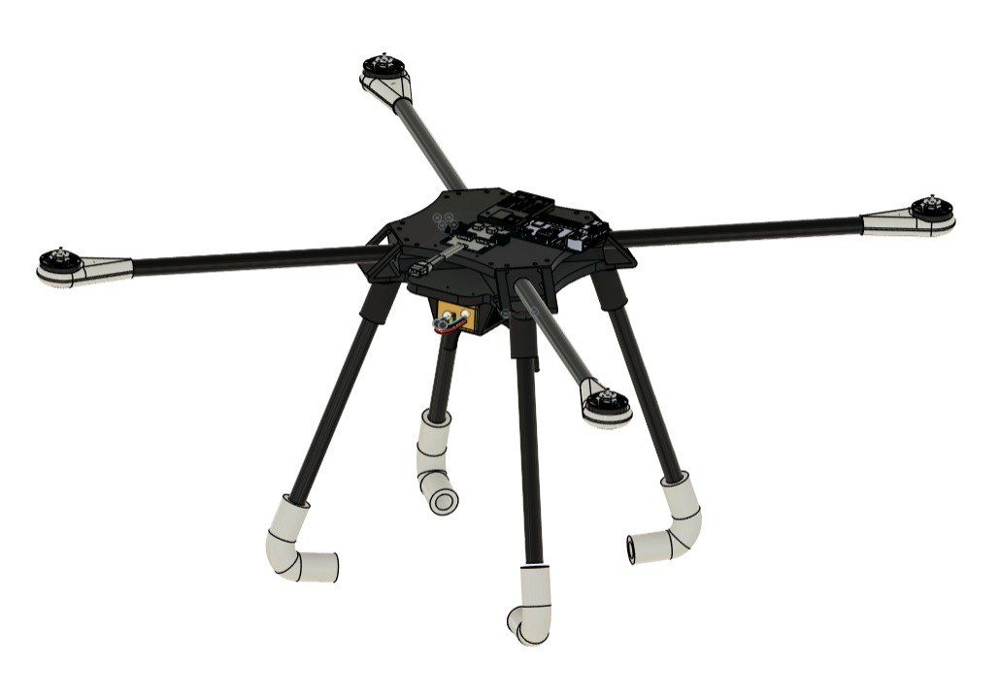
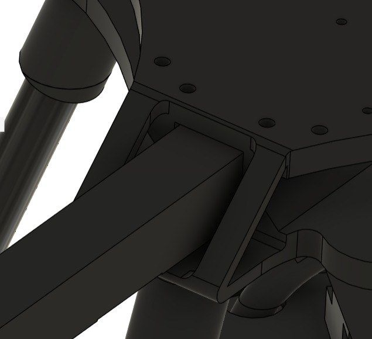
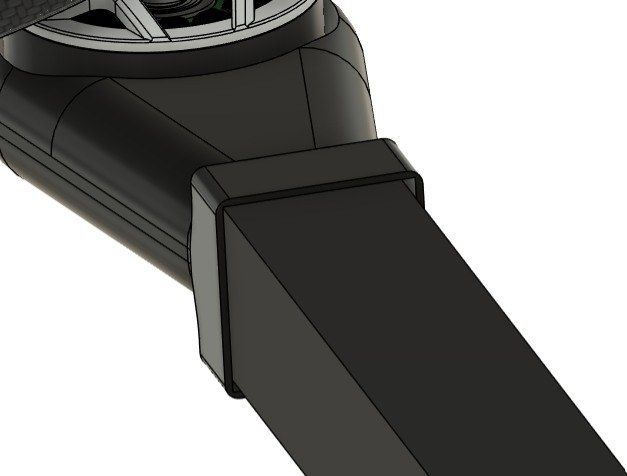
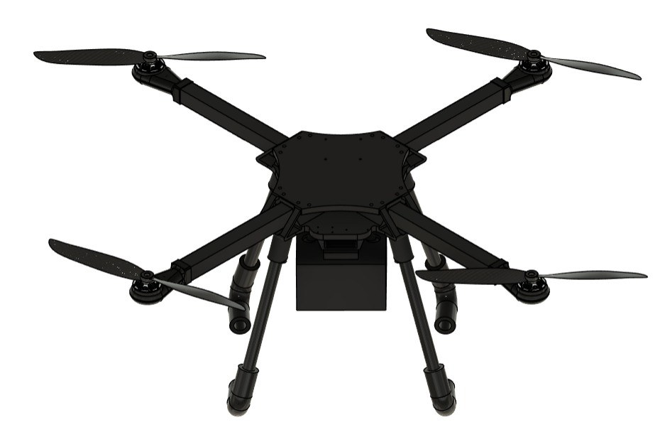
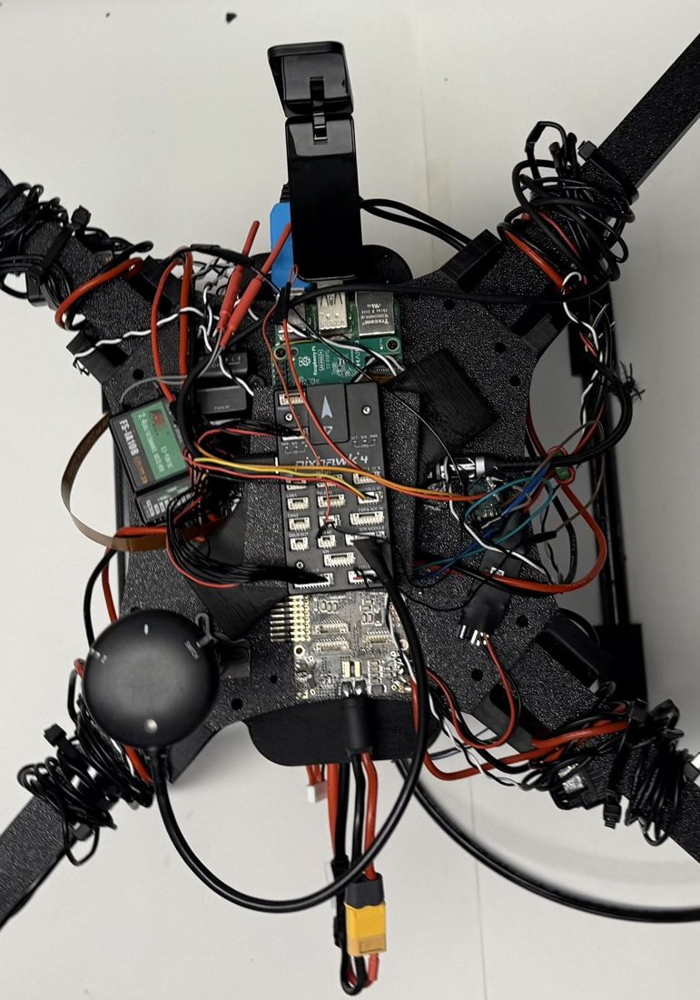

# 기체설계 상세 기록

[첫 화면](../README.md)

## 설계 대상과 하중 전달

기체는 PLA+ 중앙 프레임, 카본 튜브 암, 모터 마운트, 착륙장치 및 하부 장비 공간으로 구성됩니다. 모터가 만드는 추력은 모터 마운트와 암을 거쳐 중앙 프레임으로 전달되고, 배터리·전장품·호스 연결부는 중앙 구조에 하중을 가합니다. 따라서 모터의 고정 방향과 중앙 프레임의 질량 배치를 함께 검토했습니다.

4축 X형 배치는 4개의 추진부와 중앙 장비부를 연결합니다. 13 inch 프로펠러를 적용했으며, 외경 18 mm 카본 튜브를 암으로 사용했습니다. 전체 축간거리·튜브 내경·체결 공차는 제공된 이미지에서 역산하지 않았습니다.

## 중앙 프레임과 장착 공간

중앙 프레임은 전장 장착면이면서 암과 착륙장치가 만나는 부위입니다. 초기 CAD에서 배터리와 전장품의 공간을 검토한 뒤, 실제 조립에서는 배선과 체결부 접근까지 고려해 장비 배치를 조정했습니다. PLA+ 부품과 카본 튜브를 결합하는 구성으로 각 부위의 장착 형상을 구현했습니다.

## 암 체결: 왜 중앙과 모터 양쪽을 바꾸었는가

원형 암은 마운트 안에서 회전하면 모터의 장착 수평이 변합니다. 모터가 중앙 프레임에 대해 기울어지면 추력 방향도 달라지므로, 시험에서 확인된 회전을 접합부 문제로 다뤘습니다.

중앙부 마운트는 암이 기체 베이스에 연결되는 부위입니다. 봉을 삽입하고 감싸는 형상으로 체결하며, 베이스에 마운트를 고정합니다.

모터 측 역시 카본봉과 모터 고정부가 연결되는 부위여서 함께 개선했습니다. 외형이 사각인 것만으로 원형 봉의 회전이 완전히 막힌다고 단정할 수는 없습니다. 실제 저항은 조임력·마찰·접촉 형상에 좌우되며, 현재 기록은 모터 수평 유지의 정성 개선까지 뒷받침합니다.

## 배터리·호스·센서의 질량 배치

하부 중앙 박스에 호스 체결부를 수납하고 그 위쪽에 배터리를 배치했습니다. 배터리처럼 무거운 부품이 중심에서 멀어지면 질량 분포의 영향이 커지므로, 전장품 위치와 함께 조정했습니다. 설계 의도는 수평 편차를 줄이는 것이며, 단순히 CG를 낮추면 모든 비행 안정성이 확보된다는 뜻은 아닙니다.

전후 6 mm·좌우 4 mm 편차의 합성값은 약 7.2 mm입니다. 부호와 수직 CG 좌표, 측정 기준점의 상세 기록은 제공되지 않아 3차원 CG를 재구성하지 않았습니다.

호스 연결부를 중앙에 배치해도 옆에서 당기는 힘은 남습니다. CG에서 연결부까지의 위치를 `r`, 호스가 가하는 힘을 `F`라 하면 모멘트는 `r × F`로 설명할 수 있습니다. 정적 CG 측정과 호스 길이·방향이 바뀌는 시험을 구분해야 하는 이유입니다.

## 전장 배치와 제작

Pixhawk 4는 비행제어, Raspberry Pi 5는 센서·임무 처리를 맡고 PM07 및 UBEC가 전원 구성을 담당합니다. 배치 검토에서는 무게중심과 함께 배선 경로, 커넥터 연결, 하부 장비 공간의 간섭을 확인했습니다. 사진은 실기체 배치를 보여주는 자료이며 상세 결선도는 아닙니다.

## 추진계 검토

약 2.8 kg의 기체가 수평 정지 상태에서 이상적으로 균등 지지된다면 모터당 약 0.70 kgf가 필요합니다. 기록된 단일 모터 추력은 스로틀 70%에서 약 1.5 kgf이며, 동일 조건 합산값은 약 6.0 kgf입니다. 합산 추력/중량 비는 약 2.14입니다.

완성 기체에서는 배터리 전압, 호스 외력, 자세와 모터 간 차이가 있으므로 이 계산을 그대로 탑재량이나 호버링 스로틀로 환산하지 않았습니다. 소비전류와 가용 배터리 에너지가 없어 체공시간도 확정하지 않았습니다.

## 설계가 바뀐 근거

| 발견 | 변경 | 확인 범위 |
|---|---|---|
| 원형 암의 회전과 모터 수평 틀어짐 | 중앙·모터 측 전용 마운트 | 비행시험 중 수평 유지 개선 |
| 배터리·센서·호스가 만드는 비대칭 배치 | 배터리·체결부 중앙 적층과 전장 재배치 | CG 편차 기록 |
| 장비 탑재에 필요한 추진력 | 모터·프로펠러·ESC·배터리 조합 | 단일 모터 추력과 기체 중량 비교 |

후속 설계에서는 체결 토크별 암 회전량, 조립 전후 모터 각도, 부품별 질량·좌표, 호스 방향별 외란을 기록하면 현재의 개선을 정량적으로 비교할 수 있습니다.
