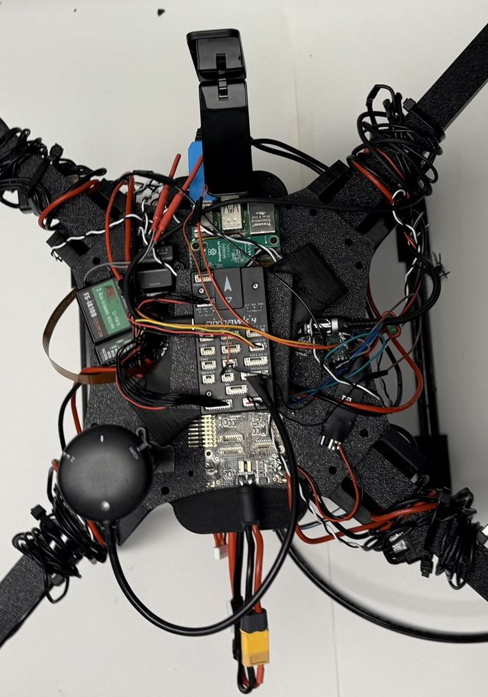
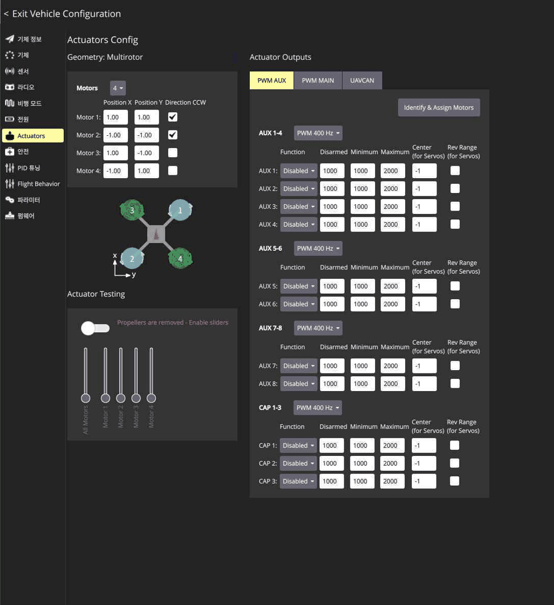
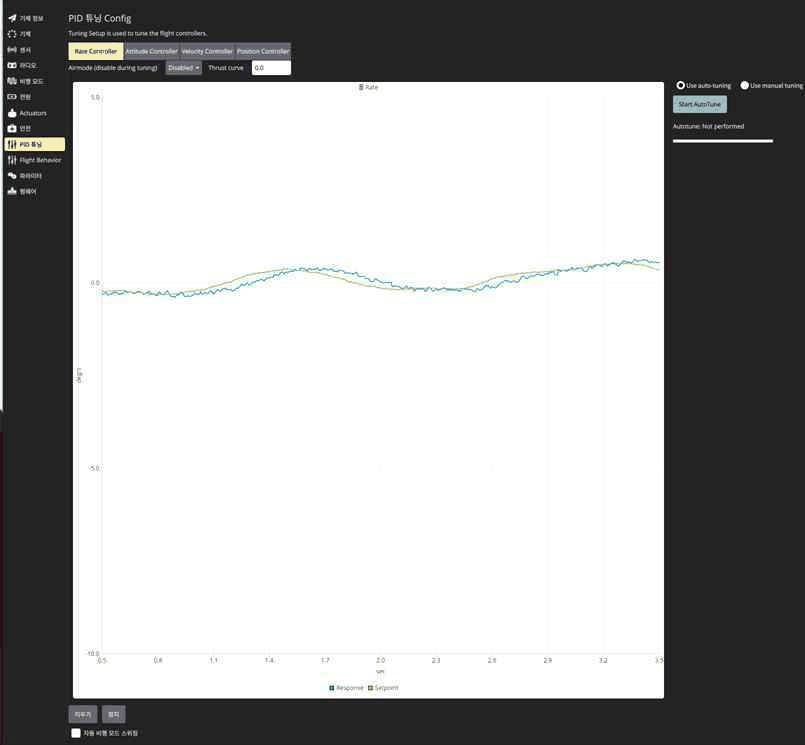
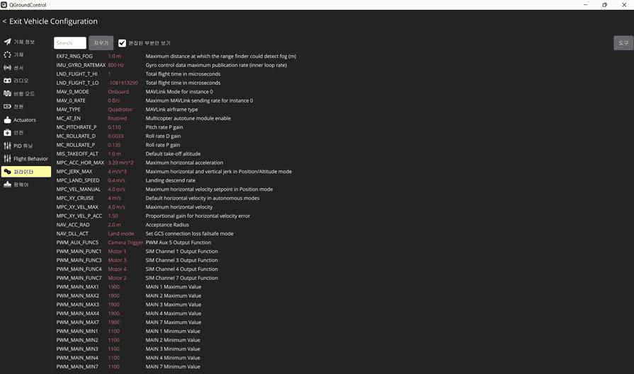
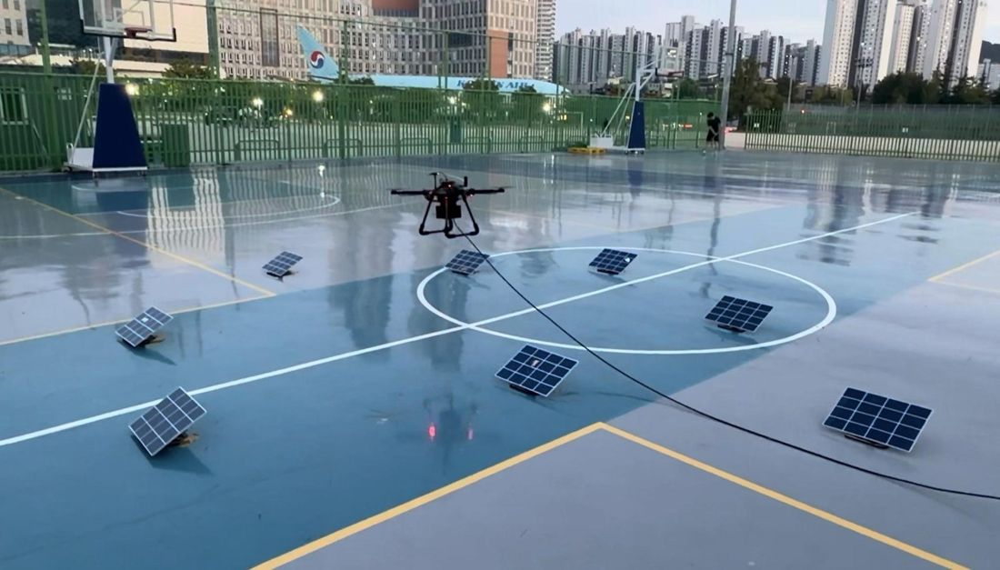

# Pixhawk 캘리브레이션과 PID 튜닝

[첫 화면](../README.md) · [기체설계](mechanical-design.md)

## 기체의 방향과 FC의 기준 맞추기

Pixhawk 4/PX4는 센서로 자세·운동 상태를 추정하고 모터 출력을 조정합니다. 기체 조립 후 센서 기준과 실제 기체 방향이 일치해야 목표 자세에 맞게 제어할 수 있습니다. 보정은 이 기준을 맞추는 과정이고 PID 튜닝은 그 뒤 응답을 조정하는 과정입니다.

*실기체 전장 사진. 센서별 캘리브레이션 완료 화면은 제공된 자료에 없어 장착 맥락을 보여주는 사진으로 사용합니다.*

| 항목 | 맞추는 기준 | 이 기체에서 확인할 이유 |
|---|---|---|
| FC 장착 방향 | FC 축과 기체 전후·좌우 축 | 보정 명령의 축이 실제 기체 움직임과 일치해야 함 |
| 가속도계 | 중력과 각 축의 기준 | Roll/Pitch 추정과 수평 판단의 기반 |
| 자이로 | 정지 상태의 회전율 기준 | 정지 상태를 회전으로 해석하는 편차 관리 |
| 나침반 | 지자기 기반 방향 | GPS·나침반 장착과 전장품 주변 환경 검토 |
| 수평 기준 | 기체의 기준 자세 | 모터 장착 수평과 FC가 인식하는 수평의 관계 확인 |

위 표는 설정 항목의 의미를 설명합니다. 프로젝트별 완료 시각·보정값·각 단계 캡처는 없어 모든 항목의 완료 증빙으로 해석하지 않습니다. 일반적인 설정 순서는 [PX4 공식 구성 안내](https://docs.px4.io/main/en/config/)를 참고했습니다.

## 모터 배열과 출력 확인

*제작설계서 p.19의 모터 시험 제어 화면.*

4축 X형 프레임의 실제 모터 위치와 FC 출력 연결을 확인하는 단계입니다. 센서 보정이 맞아도 모터 출력 연결이나 회전 방향이 실제 프레임과 맞지 않으면 의도한 자세 보정으로 이어지지 않습니다. 모터 출력 시험은 프로펠러를 제거한 상태에서 수행해야 합니다. 화면은 설정·시험 근거이며 센서 캘리브레이션 결과 화면은 아닙니다.

## 기계적 문제를 먼저 확인한 이유

카본 암이 돌아가면 모터의 추력 방향 자체가 달라집니다. 이 현상을 게인 조정만으로 다루지 않고 마운트부터 개선했습니다. 배터리·호스·전장 배치 변경 역시 기체의 질량 분포와 외란 조건에 영향을 주므로, 시험 당시의 조립 상태를 제어조건과 함께 봐야 합니다.

## PID 튜닝 화면 읽기

*제작설계서 p.19의 실시간 PID 관찰·튜닝 화면. 화면만으로 정확한 게인과 시험 구간별 수치를 판독해 추가하지 않았습니다.*

목표값과 실제 응답을 비교하면 목표를 얼마나 늦게 따라가는지, 목표를 지나치는지, 흔들림이 지속되는지 살펴볼 수 있습니다. P는 현재 오차에 대한 반응, I는 누적 오차 보정, D는 변화에 대한 감쇠와 관계가 있습니다. PX4에는 여러 제어 루프가 있으므로 이 설명을 하나의 단순 PID가 전체 위치·자세를 모두 처리한다는 의미로 사용하지 않습니다.

프로젝트에서는 Gazebo로 제어 연결과 좌표계를 사전 검토하고, 실제 기체의 반복 비행로그를 기준으로 최종 제어조건을 정했습니다. 튜닝 화면에서 setpoint와 실제 응답을 비교하는 방식은 [PX4 공식 PID 안내](https://docs.px4.io/main/en/config_mc/pid_tuning_guide_multicopter_basic)에 설명되어 있습니다. 자동튜닝 수행 이력이나 구체적인 게인 값은 제공 자료로 확인되지 않아 추가하지 않았습니다.

*제작설계서 p.35의 파라미터 화면. 설정을 관리한 실제 화면이며 변경 전후 게인 목록을 대신하지 않습니다.*

## 호버링 결과와 해석

| 항목 | 조정 전 | 조정 후 |
|---|---:|---:|
| 최대 Roll | 4.6° | 2.1° |
| 최대 Pitch | 5.1° | 2.4° |
| 평균 위치오차 | 0.14 m | 0.06 m |
| 안정화 시간 | 2.7 s | 1.4 s |

프로젝트 결과보고서의 호버링 지표입니다. 비행제어 파트와의 협업 결과로, 마운트·CG 조정만의 성과로 귀속시키지 않습니다. 원시 ULog, PID 값, 반복 횟수와 오차 측정 방법은 별도 자료가 필요합니다.

## 거리 PID와 FC 자세제어의 구분

TF-Luna는 checksum과 거리·신호 유효성을 검사하고 Median(5)·Moving Average(5)를 거쳐 거리 입력을 만듭니다. 상위 거리 PID는 1.0 m 목표와 측정 거리의 차이를 속도 명령으로 변환하고, FC는 전달된 명령에 따라 비행을 제어합니다. 이 상위 거리제어 코드를 PX4 내부 자세 PID 구현과 혼동하지 않도록 [기존 코드 설명](code-guide.md)과 연결했습니다.
